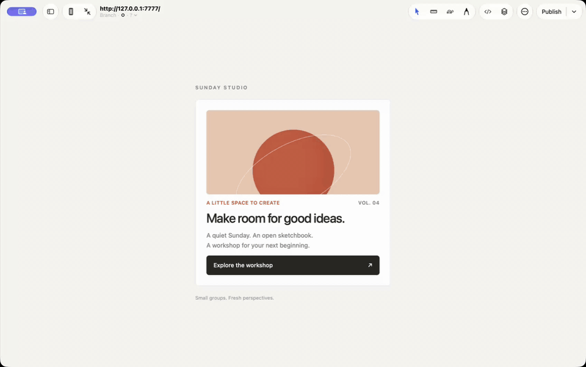
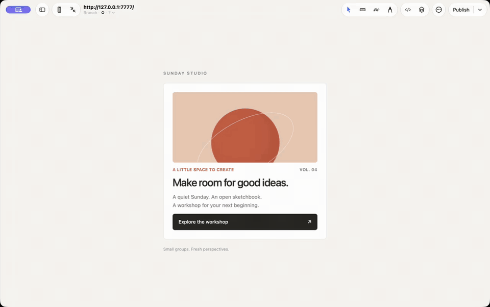

# Trezi

Trezi is a Mac app for designing and prototyping in your own code. Open a repository and
Trezi runs its dev server in a live preview on the right. An AI chat on the left edits the
running app: the real code, not a sandbox. When you're done, Trezi hands the result off
as a branch and a GitHub pull request.

## See it in action

[](docs/media/visual-editing.mp4)

**Visual editing.** Select an element on the page and change its font size and colour.

[](docs/media/spacing-handles.mp4)

**Spacing handles.** Drag padding straight on the page; the inspector follows along.

## Install

Open a coding agent that can run commands on your Mac (Claude Code, Codex or similar)
and paste this prompt:

```text
Install Trezi on this Mac. Follow https://raw.githubusercontent.com/alikimovich/trezi/main/docs/INSTALL.md
step by step: inspect what is already installed, run the official installer, verify the
result, and tell me when I need to approve something on screen or sign in. Keep my
existing projects, settings and uncommitted changes. Don't use sudo, and never print
tokens or passwords.
```

1. **Open** your coding agent.
2. **Paste** the prompt.
3. **Approve** what macOS asks for (installing the command-line tools, Keychain access)
   and sign in to your AI provider when the agent says so.
4. **Open a project** in Trezi.

Trezi is built from source on your Mac; there is no signed download. You need macOS 13.3
or later to run it. To build it you need the Xcode command-line tools with the macOS 26
SDK. You also need your own AI provider account (Claude, Codex, Gemini or an API key).
The installer adds Bun if it's missing.

**Install by hand** in Terminal instead:

```sh
curl -fsSL https://raw.githubusercontent.com/alikimovich/trezi/main/install.sh | bash
```

Options, updates, signing and troubleshooting: [docs/INSTALL.md](docs/INSTALL.md).

## First steps

1. In Trezi, click **Open project…** and pick a repository with a `dev` or `start`
   script. Trezi starts its dev server for you, so don't run it yourself.
2. Ask the chat for a change and watch the preview update.
3. Click **Select** to pick an element on the page, then chat about it or edit its
   props and styles directly.
4. When it looks right, **Publish** a branch and pull request.

Later, start Trezi from Applications or with `trezi` (`trezi .` opens the current
folder). `trezi --update` updates it.

## More

- [What Trezi does](docs/FEATURES.md)
- [AI providers](docs/PROVIDERS.md)
- [Changelog](CHANGELOG.md)
- Working on Trezi itself: [AGENTS.md](AGENTS.md) and [native architecture](docs/NATIVE.md)
